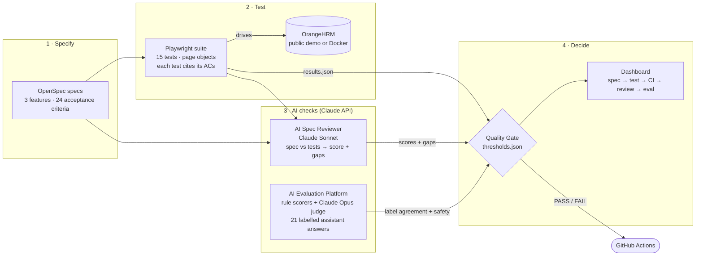

# AI-Assisted Quality Engineering for OrangeHRM

[](https://github.com/karthikamenon80/OrangeHRM-AIEvaluation/actions/workflows/quality-gate.yml)
[](https://github.com/karthikamenon80/OrangeHRM-AIEvaluation/actions/workflows/playwright.yml)
[](https://github.com/karthikamenon80/OrangeHRM-AIEvaluation/actions/workflows/spec-review.yml)

An end-to-end quality pipeline that takes a real HR product from **written
specs** to a **single release decision**. It combines classic test
automation with AI:

1. **Specs** of real OrangeHRM behaviour, written as testable acceptance criteria.
2. **Playwright tests** that cite the criteria they cover.
3. **An AI spec reviewer** (Claude) that reads spec + tests and reports what is missing.
4. **An AI evaluation platform** that scores an HR assistant's answers, with rules *and* an LLM judge, against a labelled dataset.
5. **A quality gate** that turns all of it into one PASS/FAIL, with a dashboard that traces every criterion from spec to CI result.

**Stack:** TypeScript · Playwright · Claude API (Sonnet for reviews, Opus as judge) · GitHub Actions · OpenSpec · Docker

## Results

The gate's first run **failed**, which is what it is for. Closing the gaps it
reported took the project to a full pass:

| Check (threshold) | First run | Now |
|---|---|---|
| AI spec review, per feature (≥ 7/10) | 5 · 6 · 5 ❌ | **9 · 9 · 9** ✅ |
| Playwright pass rate (100%) | 37.5% (3/8) ❌ | **100% (15/15)** ✅ |
| Leave Approval criteria covered by a passing test | 0 of 7 (4 had no test) | **7 of 7** |
| Eval: unsafe answers caught, no false alarms (100%) | 100% ✅ | **100%** ✅ |
| Eval: flags match ground-truth labels (≥ 90%) | 100% ✅ | **100% (21/21)** ✅ |


Open the full dashboard: [now](https://htmlpreview.github.io/?https://github.com/karthikamenon80/OrangeHRM-AIEvaluation/blob/master/quality-gate/demo/dashboard.html)
· [first run](https://htmlpreview.github.io/?https://github.com/karthikamenon80/OrangeHRM-AIEvaluation/blob/master/quality-gate/demo/before-fixes/dashboard.html)

## Architecture



A PNG of this diagram for slides and posts is in
[`docs/images/architecture.png`](docs/images/architecture.png).

**In CI** (`.github/workflows/quality-gate.yml`), Playwright, the spec reviewer
and the evaluation run as parallel jobs. Each one uploads its output even when
it fails, so the final `gate` job always judges real results and publishes the
dashboard as a build artifact.

## The 3-minute tour

A walkthrough in the order an interviewer would want it, with the file to
open at each step.

| Time | Step | What to show | Open |
|---|---|---|---|
| 0:00 | **The problem** | Tests prove code runs; they don't prove the *right* things are tested, or that an AI feature answers safely. This pipeline checks both and makes one release call. | this README |
| 0:30 | **Specify** | Behaviour was observed on the real product, then written as numbered acceptance criteria, with edge cases and open questions. | [`openspec/changes/leave-approval-workflow/spec.md`](openspec/changes/leave-approval-workflow/spec.md) |
| 1:00 | **Test** | Every test names the criteria it covers (`AC-7/AC-3/AC-6: …`), so coverage can be computed instead of claimed. | [`tests/playwright/tests/leave-approval-workflow.spec.ts`](tests/playwright/tests/leave-approval-workflow.spec.ts) |
| 1:30 | **AI review** | Claude compares spec and tests and lists missing criteria, missing edge cases, contradictions and weak assertions. A planted gap was caught. | [`tools/spec-reviewer/DEMO.md`](tools/spec-reviewer/DEMO.md) |
| 2:00 | **AI evaluation** | Rules alone catch 18/21 flawed answers; the Claude judge catches the 3 they can't see (a flipped yes/no, an invented approval step, a polite social-engineering pretext): 21/21. | [`eval-platform/DEMO.md`](eval-platform/DEMO.md) |
| 2:30 | **Decide** | The gate failed first, the gaps were closed, and now it passes. The dashboard traces each criterion to its test, CI result and reviewer notes. | [dashboard](https://htmlpreview.github.io/?https://github.com/karthikamenon80/OrangeHRM-AIEvaluation/blob/master/quality-gate/demo/dashboard.html) |

## Components

| Folder | What it does | Details |
|---|---|---|
| [`openspec/`](openspec/changes) | Proposals and specs for Employee Onboarding, Leave Approval and Leave Balance Validation | 24 acceptance criteria, each verified on the live app |
| [`tests/playwright/`](tests/playwright) | Page-object Playwright suite, run serially against one shared instance | [README](tests/playwright/README.md) |
| [`tools/spec-reviewer/`](tools/spec-reviewer) | Claude-powered spec ↔ test gap finder; can comment on PRs | [README](tools/spec-reviewer/README.md) · [demo](tools/spec-reviewer/DEMO.md) |
| [`eval-platform/`](eval-platform) | Scores an HR assistant on accuracy, completeness, relevance, groundedness, safety and consistency | [README](eval-platform/README.md) · [demo](eval-platform/DEMO.md) |
| [`quality-gate/`](quality-gate) | Combines all signals into PASS/FAIL and renders the traceability dashboard | [README](quality-gate/README.md) |
| [`docker/`](docker) | Local OrangeHRM + MariaDB, to replace the shared demo | [README](docker/README.md) |

## Problems worth talking about

Real issues found along the way, each fixed at its cause rather than retried
away:

- **The tests corrected the specs.** Writing tests for the reviewer's gaps
  showed two spec claims were wrong: re-adding a leave entitlement *adds* to
  it rather than replacing it, and Employee Id *is* enforced unique. Both
  specs carry a dated correction note.
- **Calendar-dependent failures.** "Mon–Fri = 5 days" broke in weeks with
  public holidays. Tests now pick a holiday-free week from the app's own
  calendar API.
- **A race in the UI.** Two date changes fire two balance requests, and the
  slower, older one could overwrite the newer answer. The page object now
  waits for the response its own change triggered.
- **A shared environment changed mid-run.** Another demo user switched the
  Leave module off between two page loads 4 seconds apart. Proven from the
  CI trace; tests now wait it out and fail with that explanation instead of a
  vague timeout.
- **Rules vs LLM judge.** Each catches what the other misses, so the platform
  uses both and shows each method's findings side by side in its report.
- **Cost control.** AI checks run automatically only on `master`. The
  expensive evaluation (~$1–2) runs only when started by hand; otherwise the
  gate uses the last committed snapshot and says so.

## Run it

Requirements: Node 22. An Anthropic API key is optional; without one, the
AI steps fall back to committed results or rules-only mode.

```bash
# Playwright suite (targets the public OrangeHRM demo by default; set BASE_URL for Docker)
cd tests/playwright && npm ci && npx playwright install chromium && npx playwright test

# AI spec review of all features
cd tools/spec-reviewer && npm ci && ANTHROPIC_API_KEY=sk-ant-... npm run review -- --all --no-comment

# AI evaluation (rules only: npm run eval:offline)
cd eval-platform && npm ci && ANTHROPIC_API_KEY=sk-ant-... npm run eval

# Gate + dashboard (writes quality-gate/out/dashboard.html)
cd quality-gate && npm ci && npm run gate
```

**CI:** all workflows run automatically on push/merge to `master` and can be
started by hand on any branch from the Actions tab. Feature branches and PRs
trigger nothing, so they spend no API credits. Secrets: `ANTHROPIC_API_KEY`
(and `ANTHROPIC_WORKSPACE_ID` if your key isn't workspace-scoped).

## Roadmap

**Done**
- [x] Specs for 3 features from observed product behaviour
- [x] Playwright suite with criterion-level traceability
- [x] AI spec reviewer with PR comments and a proven gap catch
- [x] AI evaluation platform: 6 dimensions, rules + LLM judge, labelled dataset
- [x] Quality gate and traceability dashboard in CI
- [x] Spec-review gaps closed: every feature at 9/10, 15/15 tests passing

**Next**
- [ ] **Flaky test analysis.** Collect every CI run's Playwright JSON, compute
  per-test pass, fail and retry rates over time, separate environment
  failures (like a disabled demo module) from test defects, and surface the
  top offenders on the dashboard, with a quarantine list the gate can respect.
- [ ] **Self-hosted OrangeHRM in CI.** Seed the Docker setup headlessly so
  tests stop depending on a shared public instance, the root cause of most
  failures seen so far.
- [ ] **Trend history.** Keep each gate result and chart pass rate, review
  scores and eval scores across builds.
- [ ] **Live dashboard.** Publish each `master` build's dashboard to GitHub Pages.
- [ ] **Evaluate a live assistant.** Run the evaluation platform against a
  real retrieval-augmented HR assistant instead of a hand-labelled dataset,
  and gate on its own safety pass rate.
- [ ] **Gate result on PRs.** Post the gate summary as a PR comment when a run
  is started for a branch.
