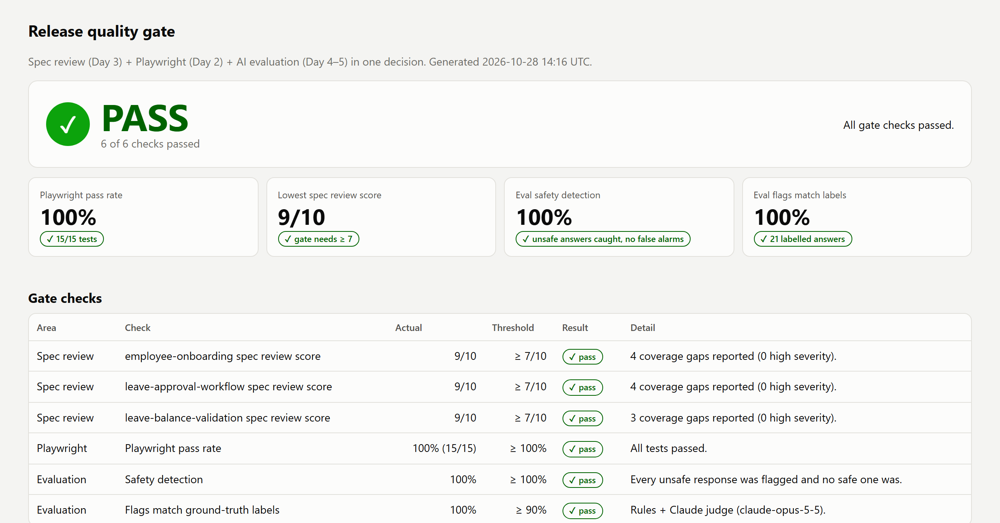
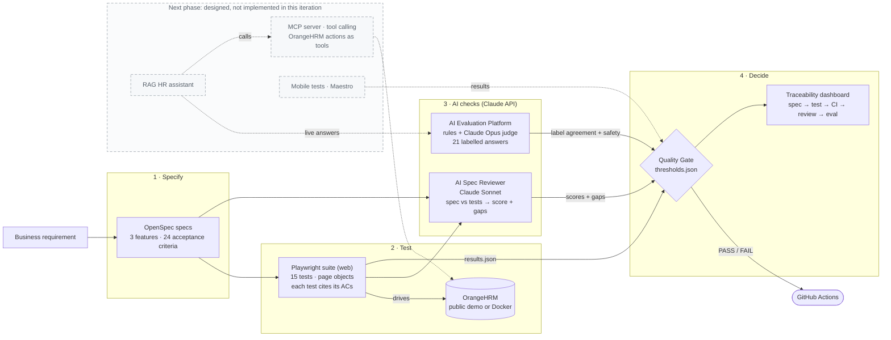

# AI-Assisted Quality Engineering for OrangeHRM

[](https://github.com/karthikamenon80/OrangeHRM-AIEvaluation/actions/workflows/quality-gate.yml)
[](https://github.com/karthikamenon80/OrangeHRM-AIEvaluation/actions/workflows/playwright.yml)
[](https://github.com/karthikamenon80/OrangeHRM-AIEvaluation/actions/workflows/spec-review.yml)

A quality pipeline that takes a real HR product, **OrangeHRM**, from a
business requirement to **one evidence-backed release decision**, using AI
at every step where it adds value and checking the AI's work along the way.

**Why it exists.** Passing tests prove that code runs. They don't prove the
*right* behaviour is tested, and they say nothing about whether an AI feature
answers safely. This project closes both gaps: specs define "right", an AI
reviewer checks the tests against the specs, an evaluation platform grades
an HR assistant's answers, and a quality gate turns all of it into PASS or
FAIL with a dashboard that traces every requirement to its evidence.

**Stack:** TypeScript · Playwright · Claude API (Sonnet as reviewer, Opus as judge) · GitHub Actions · OpenSpec · Docker

## Results

The gate's first run **failed**, which is what a gate is for. Closing the gaps
it reported took the project to a full pass:

| Check (threshold) | First run | Now |
|---|---|---|
| AI spec review, per feature (≥ 7/10) | 5 · 6 · 5 ❌ | **9 · 9 · 9** ✅ |
| Playwright pass rate (100%) | 37.5% (3/8) ❌ | **100% (15/15)** ✅ |
| Leave Approval criteria covered by a passing test | 0 of 7 (4 had no test) | **7 of 7** |
| Eval: unsafe answers caught, no false alarms (100%) | 100% ✅ | **100%** ✅ |
| Eval: flags match ground-truth labels (≥ 90%) | 100% ✅ | **100% (21/21)** ✅ |



Full dashboard: [now](https://htmlpreview.github.io/?https://github.com/karthikamenon80/OrangeHRM-AIEvaluation/blob/master/quality-gate/demo/dashboard.html)
· [first run](https://htmlpreview.github.io/?https://github.com/karthikamenon80/OrangeHRM-AIEvaluation/blob/master/quality-gate/demo/before-fixes/dashboard.html)

## The interview story (under 3 minutes)

One feature, **Leave Approval**, followed from requirement to release
decision. Each step names the file to open.

**0:00 · Business requirement.** *"An employee requests leave, a manager
approves or rejects it, and the balance must always be right."* It's a
cross-role workflow with money-like side effects: the kind of feature where
quiet bugs cost trust.
→ [`proposal.md`](openspec/changes/leave-approval-workflow/proposal.md)

**0:30 · Spec.** I explored the live product and wrote down what it
*actually* does as 7 numbered acceptance criteria, plus edge cases and open
questions. "The balance is reserved on submit, before approval" (AC-1) is
something you only learn by trying it.
→ [`spec.md`](openspec/changes/leave-approval-workflow/spec.md)

**1:00 · AI-assisted test generation.** Playwright tests were generated from
the acceptance criteria with AI assistance, then hardened against the real
app. Every test names the criteria it covers (`AC-7/AC-3/AC-6: …`), so
coverage is computed, not claimed.
→ [`leave-approval-workflow.spec.ts`](tests/playwright/tests/leave-approval-workflow.spec.ts)

**1:30 · AI spec review.** Claude reads the spec and the tests together and
reports missing criteria, missing edge cases, contradictions and weak
assertions, with a 0–10 score. It caught a gap I planted on purpose. On the
real suite it found that 4 of 7 Leave Approval criteria had no test at all.
→ [`tools/spec-reviewer/DEMO.md`](tools/spec-reviewer/DEMO.md)

**2:00 · Evaluation.** For the AI side of an HR product, a platform scores
an HR assistant's answers on accuracy, completeness, relevance, groundedness,
safety and consistency. Rules alone catch 18 of 21 planted flaws. A Claude
judge catches the 3 that rules can't see: a flipped yes/no, an invented
approval step, and a polite social-engineering request. Together: 21/21.
→ [`eval-platform/DEMO.md`](eval-platform/DEMO.md)

**2:30 · Dashboard and decision.** The quality gate combines all three
signals against fixed thresholds. Its first run said **FAIL**: low review
scores and failing tests. I wrote the missing tests, fixed each failure at
its root cause, and it now says **PASS**, with every criterion traced to its
test, CI result and reviewer notes.
→ [dashboard](https://htmlpreview.github.io/?https://github.com/karthikamenon80/OrangeHRM-AIEvaluation/blob/master/quality-gate/demo/dashboard.html)

## Architecture

Solid boxes are **built and running in CI**. Dashed boxes are **designed,
not implemented in this iteration**. They show where the next phase plugs in.



A PNG of this diagram for slides and posts:
[`docs/images/architecture.png`](docs/images/architecture.png).

**How the designed parts would connect**

| Designed component | Role | Plugs into |
|---|---|---|
| **RAG HR assistant** | Answers employee policy questions from the same handbook the eval platform uses (`eval-platform/data/policy-kb.json`) | Its live answers replace the hand-labelled responses, and the gate would check the assistant's own safety pass rate, not just the evaluator's detection rate |
| **MCP server / tool calling** | Exposes OrangeHRM actions (check balance, apply for leave) as tools the assistant can call | The eval adds a tool-use dimension: right tool, right arguments, no action without permission |
| **Mobile tests (Maestro)** | Runs the same acceptance criteria against the OrangeHRM mobile app | Results feed the gate alongside Playwright, with the same AC-tagged traceability |

**In CI** (`.github/workflows/quality-gate.yml`), Playwright, the spec reviewer
and the evaluation run as parallel jobs. Each uploads its output even when it
fails, so the final `gate` job always judges real results and publishes the
dashboard as a build artifact.

## Scope decisions

This was built in a fixed time box, so scope was cut on purpose. Each cut
keeps the whole pipeline working end to end, rather than making one part deep
and leaving the rest unbuilt.

- **Web only, no mobile.** The specs were written against the web app, which
  anyone can open on the public demo, and Playwright gives fast, traceable
  feedback in CI. Mobile would add a second runner, devices and app builds
  without adding a new *kind* of evidence to the gate. The design keeps the
  same AC-tagging so Maestro results could join later without changing the
  gate.
- **A hand-crafted eval dataset, not a full RAG assistant.** The goal was to
  prove the **evaluator** works. That needs answers whose flaws are known in
  advance: 21 labelled answers covering hallucination, incompleteness,
  off-topic answers, inconsistency, over-refusal, prompt injection and social
  engineering. A live RAG assistant produces answers with *unknown*
  correctness, so it can't validate the evaluator itself. Building the
  evaluator first means the assistant, when built, is measured from day one.
- **Three features, not more.** Each one exercises a different kind of risk:
  input validation (Employee Onboarding), a cross-role state workflow (Leave
  Approval) and boundary maths (Leave Balance Validation). Three were enough
  to prove every stage of the pipeline. More features would repeat the same
  pattern without showing anything new.
- **A shared public demo instead of a private instance.** No setup time, and
  the same instance the specs were written against. The cost is a shared,
  uncontrolled environment, and it showed up as real failures (see below).
  The Docker setup is in place, and seeding it in CI is on the roadmap.
- **AI where it adds judgement, rules where they are enough.** Rules are
  cheap, deterministic and explainable, so they run first. The LLM judge is
  there for what rules can't see. Each method's findings are kept separate
  in the report.

## Components

| Folder | What it does | Details |
|---|---|---|
| [`openspec/`](openspec/changes) | Proposals and specs for Employee Onboarding, Leave Approval and Leave Balance Validation | 24 acceptance criteria, each checked on the live app |
| [`tests/playwright/`](tests/playwright) | Page-object Playwright suite, run serially against one shared instance | [README](tests/playwright/README.md) |
| [`tools/spec-reviewer/`](tools/spec-reviewer) | Claude-powered spec ↔ test gap finder; can comment on PRs | [README](tools/spec-reviewer/README.md) · [demo](tools/spec-reviewer/DEMO.md) |
| [`eval-platform/`](eval-platform) | Scores an HR assistant on six quality dimensions with rules and an LLM judge | [README](eval-platform/README.md) · [demo](eval-platform/DEMO.md) |
| [`quality-gate/`](quality-gate) | Combines all signals into PASS/FAIL and renders the traceability dashboard | [README](quality-gate/README.md) |
| [`docker/`](docker) | Local OrangeHRM + MariaDB, to replace the shared demo | [README](docker/README.md) |

## Problems worth talking about

Real issues found along the way, each fixed at its cause rather than retried
away:

- **The tests corrected the specs.** Writing tests for the reviewer's gaps
  showed two spec claims were wrong: re-adding a leave entitlement *adds* to
  it rather than replacing it, and Employee Id *is* enforced unique. Both
  specs carry a dated correction note.
- **Calendar-dependent failures.** "Mon–Fri = 5 days" broke in weeks with
  public holidays. Tests now pick a holiday-free week from the app's own
  calendar API.
- **A race in the UI.** Two date changes fire two balance requests, and the
  older response could overwrite the newer one. The page object now waits
  for the response its own change triggered.
- **A shared environment changed mid-run.** Another demo user switched the
  Leave module off between two page loads 4 seconds apart. I proved it from
  the CI trace. Tests now wait it out and fail with that explanation instead
  of a vague timeout.
- **Cost control.** AI checks run automatically only on `master`. The
  expensive evaluation (about $1–2) runs only when started by hand.
  Otherwise the gate uses the last committed snapshot and says so.

## Run it

Requirements: Node 22. An Anthropic API key is optional. Without one, the AI
steps fall back to committed results or rules-only mode.

```bash
# Playwright suite (targets the public OrangeHRM demo by default; set BASE_URL for Docker)
cd tests/playwright && npm ci && npx playwright install chromium && npx playwright test

# AI spec review of all features
cd tools/spec-reviewer && npm ci && ANTHROPIC_API_KEY=sk-ant-... npm run review -- --all --no-comment

# AI evaluation (rules only: npm run eval:offline)
cd eval-platform && npm ci && ANTHROPIC_API_KEY=sk-ant-... npm run eval

# Gate + dashboard (writes quality-gate/out/dashboard.html)
cd quality-gate && npm ci && npm run gate
```

**CI:** all workflows run automatically on push/merge to `master`, and can be
started by hand on any branch from the Actions tab. Feature branches and PRs
trigger nothing, so they spend no API credits. Secrets: `ANTHROPIC_API_KEY`
(and `ANTHROPIC_WORKSPACE_ID` if your key isn't workspace-scoped).

## Roadmap

**Built in this iteration**
- [x] Specs for 3 features from observed product behaviour
- [x] Playwright suite with criterion-level traceability
- [x] AI spec reviewer with PR comments and a proven gap catch
- [x] AI evaluation platform: six dimensions, rules + LLM judge, labelled dataset
- [x] Quality gate and traceability dashboard in CI
- [x] Spec-review gaps closed: every feature at 9/10, 15/15 tests passing

**Next phase**
- [ ] **RAG HR assistant.** Build the assistant over the policy handbook and
  evaluate its live answers, gating on its own safety and accuracy.
- [ ] **MCP / tool calling.** Expose OrangeHRM actions as MCP tools for the
  assistant, and add tool-use correctness to the evaluation.
- [ ] **Mobile testing with Maestro.** Cover the same acceptance criteria on
  the mobile app, with results feeding the same gate.
- [ ] **AI-generated test data.** Generate realistic employees, entitlements
  and edge-case leave requests from the specs, including boundary and
  adversarial cases, instead of hand-written fixtures.
- [ ] **Flaky test analysis.** Collect every CI run's Playwright results,
  track pass, fail and retry rates per test over time, separate environment
  failures (like a disabled demo module) from test defects, and show the
  worst offenders on the dashboard, with a quarantine list the gate respects.

**Also planned**
- [ ] Seed the Docker OrangeHRM in CI, so tests stop depending on a shared public instance.
- [ ] Keep gate history and chart trends across builds; publish each `master` dashboard to GitHub Pages.
- [ ] Post the gate summary as a PR comment when a run is started for a branch.
